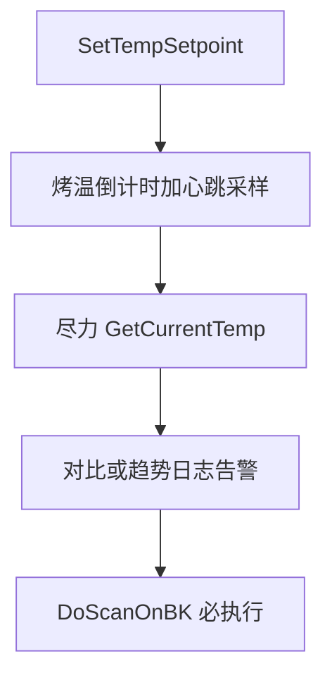

# 烤后读温不阻断快扫

## 目标

流程保持：设温 → 烤温倒计时 →（尽力）读温对比 → **必开快扫**。

到温对比只做告警/日志；**不再**因读失败、未到 ±2°C、或多等 3 分钟失败而 `ErrorBox` / 停一键 / 拒扫。

## 现状（会拦扫）

[`BakeTimeCheck_Progress`](library/UIOperateInterleaverFinalTest/UIOperateInterleaverFinalTest/OperateInteleaverFinalTest.xaml.cs) 在 `GateOk == false` 时弹错并 `EndOnekeyOnChamberFail`，不开扫。

[`WaitUntilChamberReadyAfterBake`](library/UIOperateInterleaverFinalTest/UIOperateInterleaverFinalTest/OperateInteleaverFinalTest.xaml.cs) 最多再等 3 分钟，未到温或全程读失败则 `return false`。

## 改动（单文件同一模块）

文件：[`OperateInteleaverFinalTest.xaml.cs`](library/UIOperateInterleaverFinalTest/UIOperateInterleaverFinalTest/OperateInteleaverFinalTest.xaml.cs)

### 1. 烤温线程：收集趋势样本

在 `BakeTimeCheck_DoWork` 心跳成功时额外记下：

- `firstHbTemp` / `hasFirstHbTemp`（首次成功读温）
- 已有 `lastHbTemp` / `hasHbTemp`

供烤后「读不到实测」时写趋势说明。

### 2. 重写烤后节点：尽力对比，永不 `false`（取消除外）

将 `WaitUntilChamberReadyAfterBake` 改为「评估 + 必通过」语义（可改名或保持签名，`bool` 仅表示未取消）：

1. **尽力读温**：调用现有 `TryReadChamberTempForBake`（内部已走 `UDLTccCtrl` 多轮重试），最多短轮询约 2～3 次（保留现有 `TccBakePostGatePollMs` 间隔即可），**不再**固定空等满 3 分钟才失败返回。
2. 若读到且 `|T-target| ≤ 2`：日志「到温对比通过」。
3. 若读到但偏差大：日志/告警「未到温仍开扫」，**仍视为可开扫**。
4. 若读失败：用心跳趋势判定文案（升温：`lastHb > firstHb` 且朝向目标；降温对称）；读不到样本则写「读温失败，按烤温时长满仍开扫」。
5. **仅** `CancellationPending` 时 `return false`；其余一律 `return true`，`failMsg` 改为可选告警文案（非阻断原因）。

### 3. UI 进度：完成即扫

`BakeTimeCheck_Progress` 的 `Complete` 分支：

- **始终** `DoScanOnBK()`（未取消的完成态）。
- 有实测：界面显示烤温完成 + 温度；文案区分「对比通过」与「未到温/读失败仍开扫」。
- **删除** `ErrorBox`、拒扫、`EndOnekeyOnChamberFail` 的烤后门禁分支。

### 4. 文案

- 开始烤温处「满时长后开扫前校验 ±2°C」改为「满时长后尽力读温对比，随后开扫（对比失败不阻断）」。
- 保留心跳读失败仅告警、不中断烤温（已有逻辑不动）。

## 不改

- `UDLTccCtrl` 重试策略
- 同温后续产品跳过读温（已落地）
- 开扫前 `PrepareChamberAndScan` 首次进温点仍读温决定是否烤温（本次只改**烤后**节点）

## 验收

- 烤后 TCC `0x00120091` / `-9999`：有告警日志，**仍自动开扫**，无 ErrorBox 停流程。
- 读到但偏离 >2°C：告警「未到温仍开扫」，仍开扫。
- 读到且到温：提示通过后开扫。
- 用户取消烤温：仍不开扫。
