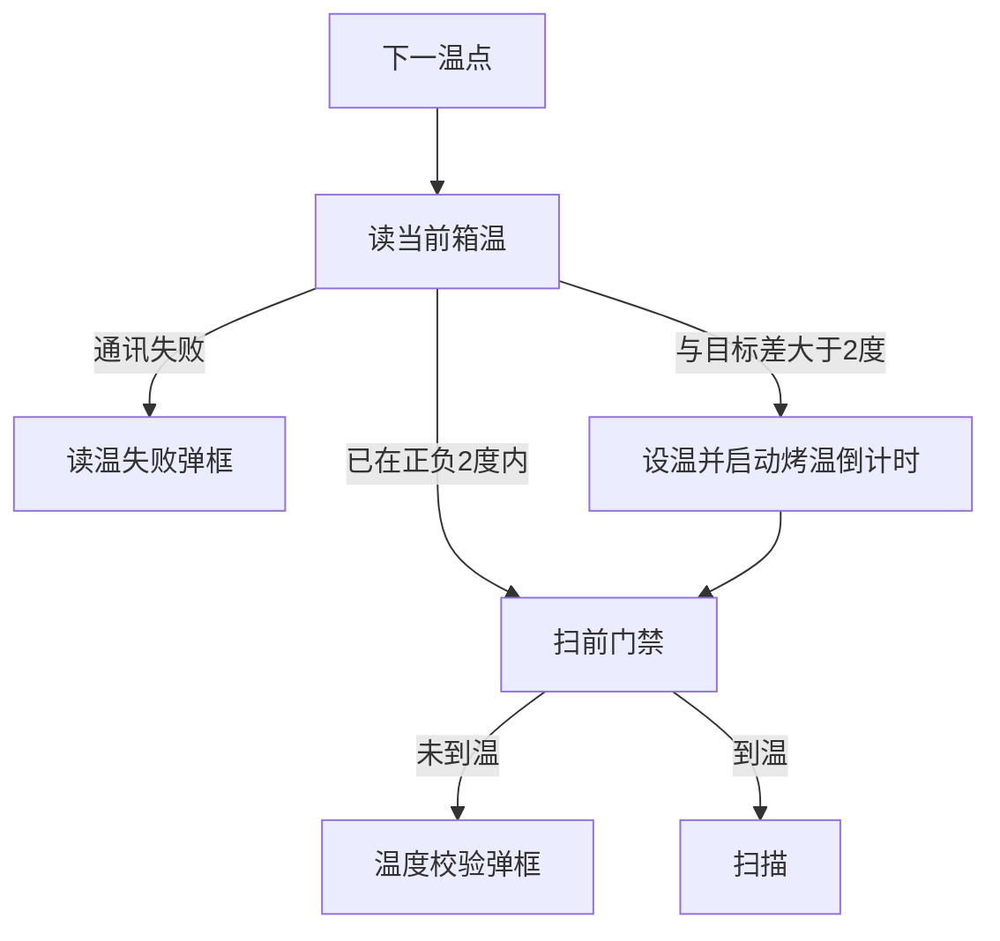

# 修复三温切换被烤温前温差框卡住

## 原因

[`BeginChamberPrepOrScan`](library/UIOperateInterleaverFinalTest/UIOperateInterleaverFinalTest/OperateInteleaverFinalTest.xaml.cs) 在 `SetTempSetpoint` 和 `StartBakeCountdown` 之前调用 `TryReadChamberTemperatureWithOperatorConfirm`。读温成功但 `|实测 − 目标| > 2°C` 时弹出「循环箱温差确认」。LT（−5°C）切 HT（55°C）这个差值必然大于 2°C，倒计时还没开始。「重试」只是再读一次，不会下发高温设定。

点「通过继续」才会进入烤温，所以这张框不是在保护已升温的测试，而是挡在升温前面。

## 修复

只改 [`OperateInteleaverFinalTest.xaml.cs`](library/UIOperateInterleaverFinalTest/UIOperateInterleaverFinalTest/OperateInteleaverFinalTest.xaml.cs) 里读温成功且温差大于 ±2°C 的分支（约 3887–3902 行）：

- 去掉烤温前的 `ShowTccOperatorConfirmDialog("循环箱温差确认", ...)`。
- 读到实测后记一条状态：当前温度、目标温度，然后 `return Success`，并带上 `hasActualReading = true`。
- 后面的现有逻辑不变：`IsBakeRequired` 看到温差大于 ±2°C 会设温并 `StartBakeCountdown(TmptChangeTimes)`（模板 25 分钟）。已在 ±2°C 内则仍跳过烤温、直接走扫前门禁。

保留的弹框：

- 读温通讯失败：「循环箱读温」（通过 / 重试 / 终止）。LT/HT 点通过仍必须设温并烤温，不能跳过。
- 烤温结束、开扫前：`TryValidateChamberTemperatureWithConfirm`。常温仍可通过继续；LT/HT 仍只能重试或终止，禁止未到温就扫描。

把「开始进行 x°C 拷温」补上当前实测和烤温分钟数，现场能看到升温已经开始，而不是被确认框拦住。同步该方法的注释。

## 变温后的顺序

