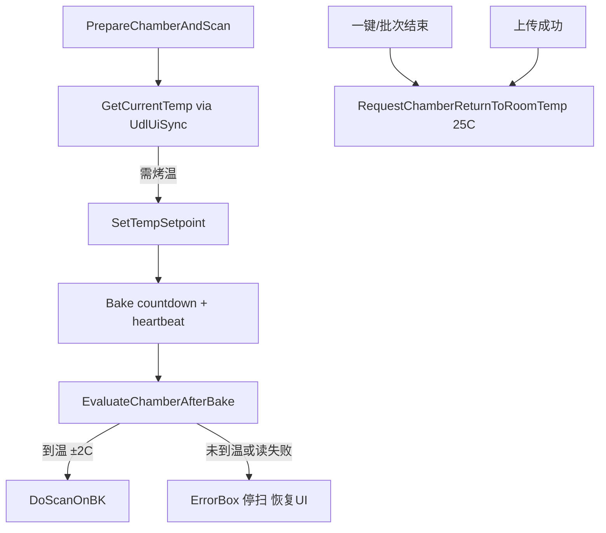

# 恢复 TCC 质量门禁与三温回常温（FTS）

## 背景与约束

根因结论（`820e8d8`）：UDL COM 套间要求调用落在 **同一 UI/STA 线程**。现有 [`UDLTccCtrl.cs`](library/DeviceControl/DeviceControl/TCC/UDLTccCtrl.cs) 已通过 `UdlUiSync.Send` + `UdlEngineLock` 落实——**本方案不改动该层**。

为排查 TCC 不稳定，业务层曾把「质量门」改成「永不挡扫」；在 COM 线程问题已定位后，应把门禁恢复回来。

## Git 对照：要恢复 vs 保持

| 能力 | 引入/参考提交 | HEAD 现状 | 动作 |
|------|---------------|-----------|------|
| UDL 走 UI 线程 | `820e8d8` | `UdlUiSync.Send` 已有 | **保持不动** |
| 烤后到温对比 | `8c7df4b` 引入对比但写死仍开扫；门禁精神见 `d075b71`/`b11a3f3`/`eeb9cb3` | `EvaluateChamberAfterBake` 除取消外恒 `true`；Progress 里无条件 `DoScanOnBK` | **改为未到温则阻断** |
| Prepare 失败仍扫 | 容错阶段加的 UI suppressed | TCC 空/读温失败/设温失败仍 `DoScanOnBK` | **改为失败停扫** |
| 三温后回常温 | `0678541` → `RequestChamberReturnToRoomTemp`；`b11a3f3` 一键结束+上传后再设 | 方法已删；仅上传成功裸调 `SetTempSetpoint(25)` | **恢复方法并在一键结束/上传闭环调用** |
| 常温 MAXIL/MINIL 闸门 | `a9c3093` | 仍在 | 保持 |
| 同温跳过读温 | 后续优化 | 仍在 | 保持 |

主要改文件：[`OperateInteleaverFinalTest.xaml.cs`](library/UIOperateInterleaverFinalTest/UIOperateInterleaverFinalTest/OperateInteleaverFinalTest.xaml.cs)。不改 `UDLTccCtrl` 的 UI 封送策略。

## 实现步骤

### 1. 烤温结束后门禁改为硬阻断

文件内现状（约 785–878、726–739 行）：

- `EvaluateChamberAfterBake`：未到温/读失败仍 `return true`（「仍开扫」）
- `BakeTimeCheck_Progress`：`Complete` 时无条件 `DoScanOnBK()`

改为：

1. `EvaluateChamberAfterBake`：到温（`|actual-target| ≤ TccBakeReadyToleranceCelsius`）→ 允许开扫；轮询耗尽仍未到温或全程读失败 → `return false`，`advisoryMsg` 写清原因。
2. `BakeTimeCheck_DoWork`：`proceed==false` 时 `ReportProgress` 带 `Complete=true, GateOk=false`（不要直接开扫）。
3. `BakeTimeCheck_Progress`：仅 `GateOk==true` 时 `DoScanOnBK()`；否则 `ErrorBox`/`RealtimeMsg`、若 `bakeStartedAsOnekey` 则恢复一键 UI（对齐已删除的 `RestoreUiOnChamberFail` 精简版），**禁止开扫**。

容差继续用现有常量 `TccBakeReadyToleranceCelsius = 2.0`；烤中心跳只打日志，不单独挡扫。

### 2. 收紧 `PrepareChamberAndScan`

现状：TCC 未连接 / `GetCurrentTemp` 失败 / `SetTempSetpoint` 失败 → 日志 UI suppressed 后仍扫。

改为（与 `b11a3f3`/`eeb9cb3` 门禁精神一致）：

- TCC 未配置且本温区需要烤温 → 明确失败，不停装死开扫。
- 设温失败 → `ErrorBox` + `EndOnekeyOnChamberFail`，不启动烤温线程、不开扫。
- 读温失败：不再「假定无需烤温就扫」；按失败处理或强制进入烤温设温路径（优先：**读失败则仍下发目标温并烤温**，烤后再走步骤 1 硬门禁）。同温已确认跳过读温逻辑保留。

### 3. 恢复 `RequestChamberReturnToRoomTemp`（25°C）

从 `0678541` / `b11a3f3` 取回方法：

- `TryGetTcc` → `SetTempSetpoint(25)`（走现有 `UDLTccCtrl`，自然 UI 线程）
- 成功/失败用 `RealtimeMsg`（勿因回常温失败卡死上传）

调用点：

1. **一键/多温流程正常结束**（弹出「一键测试结束」类 MessageBox **之前**）
2. **上传成功**收尾（替换或包装现有 5077–5083 行裸 `SetTempSetpoint(25)`）

单项只测一温结束也调用一次，保证箱体不长期停在高/低温。

### 4. 验证

- Debug\|x86 编译 `UIOperateInterleaverFinalTest`
- 人工：烤温到时故意未到温（或短烤）→ 应弹错且**不扫**；到温 → 开扫
- 一键三温跑完 → 日志/状态有「回常温 25°C」，箱体设温变为 25
- 确认读温/设温仍只经 `UDLTccCtrl`（调用栈含 `UdlUiSync`），无后台线程直调 COM

## 明确不做

- 不回滚 `UdlUiSync` / 不把 TCC 再甩回任意后台线程直调 COM
- 不整份 cherry-pick `eeb9cb3`/`b11a3f3`（体积大且含已 Revert 的其它实验）
- 不改自动化/光谱调节 ATS 包；范围仅 FTS 终测模块
