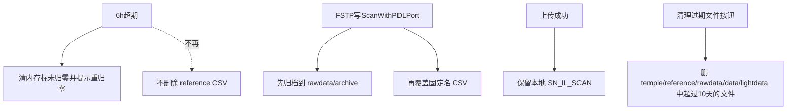

# 快扫/归零数据保留与清理

## 目标行为

## 1. 6h 超期：仍严格失效，但不删文件

文件：[OperateInteleaverFinalTest.xaml.cs](library/UIOperateInterleaverFinalTest/UIOperateInterleaverFinalTest/OperateInteleaverFinalTest.xaml.cs) 中 `ClearAllReferenceDataDueToExpiry`（约 502–517 行）。

- **保留**：`InitRawdataBuffer`、`IsRef = false`、`UpdateReferenceStatus`、重置 `oldestRefTime` / `refSessionWriteTime`、`RealtimeMsg` 提示须重归零；`ShouldDeferRefExpiryClear` / `IsRefTimePassdue` / 红字计时逻辑不动。
- **去掉**：对 `referenceWithPDLPort-*.csv` 的 `File.Delete`。
- **文案**：改为「归零数据已超期，请重新系统归零。」（去掉「并已清除」）。

磁盘上旧 CSV 仅供人工回归；业务上超期后仍必须点「系统归零」才能测。

## 2. 主界面按钮：清理 10 天前所有运行数据文件

UI：[OperateInteleaverFinalTest.xaml](library/UIOperateInterleaverFinalTest/UIOperateInterleaverFinalTest/OperateInteleaverFinalTest.xaml) 在操作区加按钮（建议 `Grid.Row="0" Grid.Column="2"`，文案「清理过期文件」，ToolTip 说明范围与 10 天）。

逻辑（同文件 code-behind）：

- 确认框：明示将删除 `temple`、`reference`、`rawdata`（含 `archive`）、`data`、`lightdata` 下 **LastWriteTime 早于 Now-10 天** 的文件（递归子目录）。
- 扫描中（`!GetIsScanFinished()`）或烤温中则拒绝并提示稍后再清。
- 按上述 5 个目录相对 `Environment.CurrentDirectory` 枚举文件；删除失败记日志并汇总；完成后 `RealtimeMsg` + MessageBox 报告删除个数。
- 若当前内存归零对应文件被删，不强制改 `IsRef`（业务仍靠 6h 计时；清理主要针对历史残留）。

常量：`private const int staleDataDays = 10;`

## 3. rawdata 临时快扫时间戳归档

写入点：[UDLFSTPScan.cs](library/DeviceControl/DeviceControl/FSTPScan/UDLFSTPScan.cs) 在 `File.Open(path, FileMode.Create)` 之前（两处写 CSV 循环，约 118 与 437 行附近）。

- 若目标 `ScanWithPDLPort{n}.csv` 已存在：复制到  
  `{CurrentDirectory}\rawdata\archive\{yyyyMMdd_HHmmss}_ScanWithPDLPort{n}.csv`  
  （目录不存在则创建；复制失败只写日志，不阻断扫描）。
- 再 `FileMode.Create` 覆盖固定名文件。

## 4. 上传后保留本地 `SN_IL_SCAN_*`

同 Operate code-behind 上传成功段（约 4427–4441 行）：**删除** `foreach` 内对 `copiedLocalPaths` 的 `File.Delete`；保留日志改为「保留本地 CSV: …」便于核对。服务器 SN 目录复制与上传流程不变。

## 涉及文件

- [OperateInteleaverFinalTest.xaml](library/UIOperateInterleaverFinalTest/UIOperateInterleaverFinalTest/OperateInteleaverFinalTest.xaml)
- [OperateInteleaverFinalTest.xaml.cs](library/UIOperateInterleaverFinalTest/UIOperateInterleaverFinalTest/OperateInteleaverFinalTest.xaml.cs)
- [UDLFSTPScan.cs](library/DeviceControl/DeviceControl/FSTPScan/UDLFSTPScan.cs)

不改 `MainWindow` 建目录逻辑；`rawdata\archive` 由首次归档时创建。

## 验证

- 超期：界面仍提示重归零、`IsRef` 失效，但 `reference\*.csv` 仍在。
- 连续两次 FSTP：`rawdata\archive` 出现带时间戳的旧 `ScanWithPDLPort*.csv`。
- 上传成功：本地 `rawdata\{SN}_IL_SCAN_*.csv` 仍在。
- 「清理过期文件」：仅删 LastWriteTime&gt;10 天的文件；新文件保留；需确认框。
