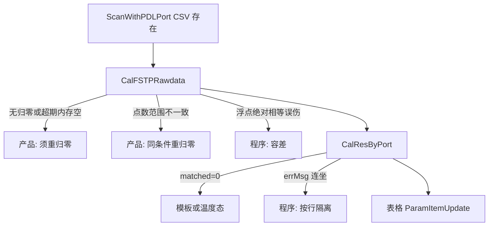

# CalFSTPRawdata / CalResByPort：程序还是产品？怎么做到最好

## 结论（先定性）

**不是单一原因。** 同一段链路里两类问题混在一起：

| 日志表现（搜 `[ScanCalDiag]`） | 归属 | 正确处理 |
|-------------------------------|------|----------|
| `IsRef=False` / `无归零数据` / `portPDLRef pts=0` / `SKIP (scan fail)` 且超期提示 | **产品/工艺规则** | 必须重新「系统归零」；程序应**挡在扫前**并说清楚，而不是悄悄用旧文件凑合 |
| `wlMismatch` / `ptsMismatch` 且两端扫描范围或步进本就不该一致 | **产品/操作** | 同范围重归零后再测 |
| `testWL==refWL` 几乎相等却因 double 绝对相等失败 | **程序脆弱** | 改容差比较 |
| `CalFSTPRawdata FAIL` 后仍有半截扣减、或 `errMsg` 一次失败导致整口后续参数全不写 | **程序设计** | 失败即停并回滚；按行隔离错误 |
| `CalResByPort matched=0`（温度/端口名对不上） | **多为模板/配置或温度态** | 查 `curTmpt` 与模板行；程序可加强日志与扫前校验 |
| `ENTER CalAllResultInThread` + `updated>0` 但 `ParamItemUpdate testedNonDefault=0` | **程序/UI 同步** | 查列表只显示总通道行、值未同步到 show 行 |

业务上 **6 小时必须重归零** 是刻意限定（你们已确认保留提示+失效）。磁盘上仍有 `reference\*.csv` **不等于** 业务上可用——超期后内存清空是预期；操作员若只看文件「还有」会误判成程序丢数，这是**认知差**，不是快扫坏了。

## 做到最好的工作流（推荐顺序）

### 第 0 步：用现有诊断日志定性（本轮先做）

复现一次「有 CSV、表空」后，在 `Log\*log.txt` 搜 `[ScanCalDiag]`，按上表对号入座。

- 若停在 `CalFSTPRawdata FAIL` + `IsRef=False` / `pts=0` → **先当产品问题处理**（重归零），不要先改算法「跳过扣归零」。
- 若 `CalFSTPRawdata OK` 且 `ENTER CalAllResultInThread`，看 `CalResByPort summary` 的 `matched/updated/fail`。

**在未看到日志定性前，不建议改业务语义（例如超期仍自动读盘当合法归零）。**

### 第 1 步：只加固明确的程序问题（日志证实后再改）

目标文件：

- [InterleaverScanResult.cs](library/UIOperateInterleaverFinalTest/UIOperateInterleaverFinalTest/InterleaverScanResult.cs) — `CalFSTPRawdata`
- [OperateInteleaverFinalTest.xaml.cs](library/UIOperateInterleaverFinalTest/UIOperateInterleaverFinalTest/OperateInteleaverFinalTest.xaml.cs) — 扫前校验、`CalResByPort`

拟定加固（默认方案，不绕过 6h 规则）：

1. **`CalFSTPRawdata` 波长比较**  
   将 `testWL[i] == refWL[i]` 改为容差（例如 `|dWl| <= 1e-6` nm，或相对步进的一小部分）。点数不等仍直接失败并要求重归零。  
   任一点超差：**立即 return**，不再半截扣减。

2. **扫前硬校验（防「扫完了才发现无归零」）**  
   在 `IsScanRef` 通过后、或 `ScanAndCalResultFSTP` 测试分支读 CSV 前：检查 `portPDLRef[dataIndex]` 点数 > 0；若 `IsRef==true` 但缓冲空，记错误「归零内存丢失，请重新系统归零」并 **return 2**，避免空跑快扫。

3. **`CalResByPort` 错误隔离**  
   单参数 `CalChannelTestParam` 失败只记该行日志与该行不更新，**不要**把 `errMsg` 累加后阻断同口后续参数；口级汇总写 `[ScanCalDiag] CalResByPort summary`。

4. **文案**  
   超期/无归零继续明确「请重新系统归零」；波长/点数不一致写清 ref/test 点数与首点波长（日志已有，可同步到弹窗）。

### 第 2 步：明确不做的事（避免把产品规则改坏）

- 不自动用磁盘超期 `reference\*.csv` 冒充合法归零去扣减。  
- 不取消 6h 失效与提示。  
- 不在无归零时「直接显示未扣减功率」当正式结果（会污染良率）。

## 你怎么判断「该找工艺还是该改代码」

- **工艺/产品**：超期未重归零、改了模板扫描范围未重归零、光路/PM 对错口。  
- **程序**：日志显示点数相同、波长差在 1e-7～1e-5 量级却 `wlMismatch`；或 `matched>0` 但因一次 `errMsg` 后面全空；或 `IsRef=true` 但 `pts=0`。

## 落地前提

先贴一轮完整 `[ScanCalDiag]` 片段（从 `Scan_DoWork` 到 `ParamItemUpdate`），确认属于上表哪一类后，再执行第 1 步代码加固；若已是「无归零/超期」，则**无需改算法**，按重归零操作闭环即可。
