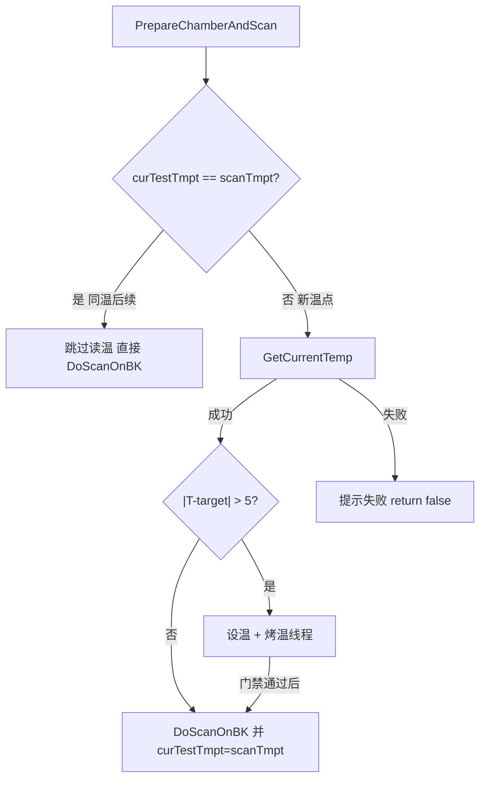

# 同温后续产品跳过循环箱读温

## 问题

[`PrepareChamberAndScan`](library/UIOperateInterleaverFinalTest/UIOperateInterleaverFinalTest/OperateInteleaverFinalTest.xaml.cs) 在每次开扫前都调用 `GetCurrentTemp`。一键/多项产品同温（如全部 23°C）时，每个产品都会打一次 UDL 读温；现场已出现 `0x00120091` /「读取循环箱温度失败」，中间产品被门禁打断。

## 策略（已选定）

用现有 `curTestTmpt` 表示「本批已确立的测试温度」：

- **首次**进入某目标温（`curTestTmpt` 与 `scanTmpt` 不同，或哨兵 `-300` / 初始 `-1`）：照旧读温 → 判断是否烤温 → 设温/心跳/门禁不变。
- **同温后续**（`curTestTmpt == scanTmpt`）：**跳过** `GetCurrentTemp` / 设温 / 烤温，直接 `DoScanOnBK()`。
- **换温点**（下一温如 -5 / 55）：`scanTmpt != curTestTmpt`，再次完整读温与烤温流程。
- **不改**：烤温中 60s 心跳、烤后 ±2°C 门禁、`UDLTccCtrl` 重试逻辑。



## 改动点（单文件）

仅改 [`OperateInteleaverFinalTest.xaml.cs`](library/UIOperateInterleaverFinalTest/UIOperateInterleaverFinalTest/OperateInteleaverFinalTest.xaml.cs) 中 `PrepareChamberAndScan`：

在获取 `tccCtrl` / 读温之前增加早退：

```csharp
// 同温已确立：后续产品/续测不再打 GetCurrentTemp
if (curTestTmpt.CompareTo(scanTmpt) == 0
    && curTestTmpt.CompareTo(-300) != 0
    && curTestTmpt.CompareTo(-1) != 0)
{
    RealtimeMsg(string.Format("同温 {0}°C 已确认，跳过循环箱读温，直接扫描", scanTmpt));
    DoScanOnBK();
    return true;
}
```

说明：

- `curTestTmpt` 在「无需烤温直接扫」与「开始烤温」两处本就会写成 `scanTmpt`（约 4125、4147 行）；烤完门禁通过后继续扫，后续 `OnekeyScan` / `ContinueSingleScanSameTemperature` / 再点单项同温都会命中跳过。
- 开模板处已有 `curTestTmpt = -300`（约 1162 行），新批次会重新读温，无需额外标志位。
- 打一行 `RealtimeMsg` + 可选 `WriteLog`，便于现场区分「跳过」与「读失败」。

## 验收

- 一键同温多产品：仅**第一个**产品（或换温后的第一个）出现「读取循环箱温度」；后续为「同温已确认，跳过…」。
- 换温（23 → -5 / 55）：仍读温；需烤则仍走满时长 + 门禁。
- 读温失败时：仅影响**尚未确立该温**的那一次；同温已确立后不再因反复读温拖垮中间产品。
- 打包 Debug 模块 DLL 的步骤与此前一致（实现阶段再做）。
