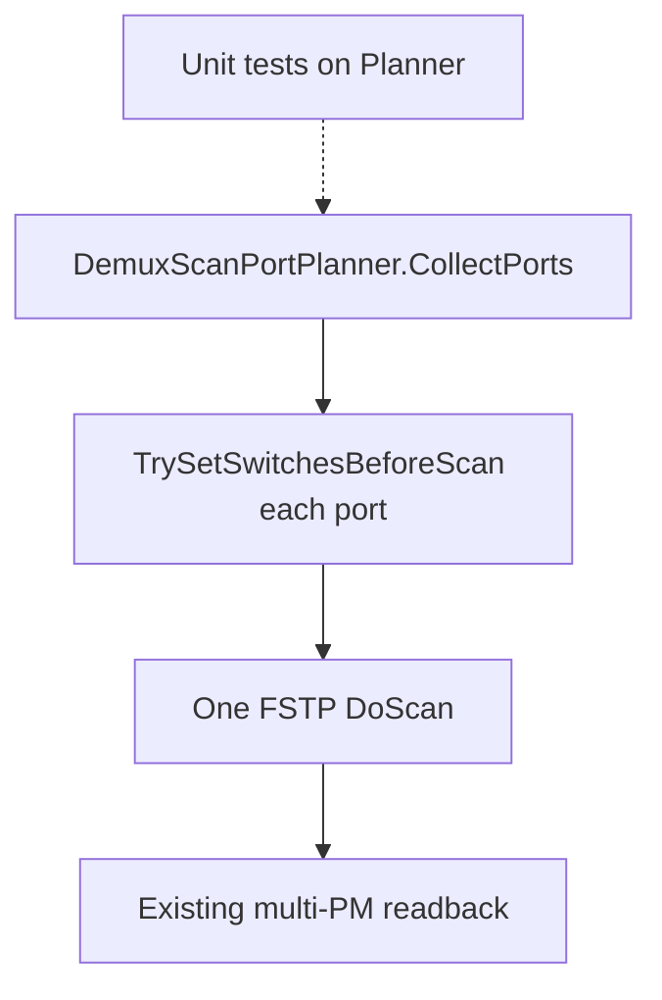

# TCC 静默稳产能 + Demux Even/Odd 同测（优雅可测）

## 已确认的产品决策

| 问题 | 决策 |
|------|------|
| 1 设温弹框 | **接受**：静默减少人工干预；目标是 **稳定 + 产能** |
| 2 Even/Odd | **必须做好**：同温同产品一次扫描；**能做的单元测试要做**；修改要 **最小且优雅** |

---

## 问题 1：静默设温（稳产能）

### 行为（固定）

1. **保留**（稳定性）：Set 重试、驱动 setpoint 读回、趋势观察窗。  
2. **去掉**：`循环箱设温` 的 Yes/No/Cancel 弹框与无限「否=再试」人工环。  
3. 重试+趋势仍失败 → `WriteLog` + `RealtimeMsg` 警告 → **按 Success 继续烤温/一键**（不停线）。  
4. **不改**：读温温差弹框、扫前 ±2°C 门禁（未到温的最后闸门，有利于「稳」；若以后也要无弹再单开）。  
5. **不改** `UDLTccCtrl`。

产能含义：RT→LT 等切换不再等人点确认；偶发 UDL 失败不挡三温流水。

改动点：仅 [`TrySetChamberSetpointWithOperatorConfirm`](library/UIOperateInterleaverFinalTest/UIOperateInterleaverFinalTest/OperateInteleaverFinalTest.xaml.cs) 失败兜底分支。

---

## 问题 2：Demux Even+Odd 同测 —— 优雅改法 + 单测

### 根因（不变）

Demux 被特判为每次只 `Ports.Add` 一个口；非 Demux 仍按 `ScanIndex` 合并。FSTP/多 PM 读回其实已支持多口。

### 优雅设计（避免再堆三处复制 if）

把「选哪些口同扫」和「扫前怎么切开关」抽成 **无 WPF 依赖的小模块**，UserControl 只调用：

建议新文件（与终测工程同目录或同命名空间）：

- [`DemuxScanPortPlanner.cs`](library/UIOperateInterleaverFinalTest/UIOperateInterleaverFinalTest/DemuxScanPortPlanner.cs)（名称可微调）

职责（纯静态 / 无设备 IO）：

```text
CollectPortsForScan(assists, productId, scanTmpt, isDemuxDual)
  - Demux：同 ProductIndex + 同 TestTmpt + 未测 → 全部 PortIndex（Even+Odd）
  - 非 Demux：保持现逻辑（同 ProductIndex + ScanIndex + TestTmpt）
  - 返回排序后的 port 列表 + 用于切开关的 portKey 列表

ResolveDemuxOutputChannel(productIndex, portIndex)  // 可把现有 static 迁入或委托，便于测
```

UserControl 侧薄封装：

```text
TrySetSwitchesBeforeScan(productId, portKeys)
  - 对每个 portKey 调现有 SetSwitch（先 Even 后 Odd 或按 PortIndex 升序，约定写死并测）
  - 任一失败则 false（行为与现单口失败一致）
```

接线（只改调用，不复制三套逻辑）：

- `OnekeyScan`
- `ContinueSingleScanSameTemperature`
- `btnSingleScan_Click` 组 Ports 处  

Demux 同温一次扫完两口后，单项续扫自然结束。

**归零**：仍串行（本迭代不扩 scope）。

### 单元测试（必做）

仓库暂无终测专用测试工程 → **新增**轻量测试项目，例如：

[`library/UIOperateInterleaverFinalTest.Tests/UIOperateInterleaverFinalTest.Tests.csproj`](library/UIOperateInterleaverFinalTest.Tests/UIOperateInterleaverFinalTest.Tests.csproj)

- 框架：与解决方案一致的 **.NET Framework** + **MSTest 或 NUnit**（跟现有可复用包选一个，优先 MSTest 简单）。  
- 引用：能引用到 `DemuxScanPortPlanner` 的工程（终测 csproj 或把 Planner 放到 MolexUtility 若引用更干净；**默认放终测工程内 + InternalsVisibleTo**，避免大挪接口）。

至少覆盖：

1. Demux 同 SN 同温两口未测 → 合并为 `[1,2]`（或实际 PortIndex）。  
2. 一口已测一口未测 → 只含未测口。  
3. 不同温度 / 不同 SN → 不合并。  
4. 非 Demux → 仍按 ScanIndex 合并（回归老行为）。  
5. `GetDemuxOutputChannelForPortIndex`：PORT1→17 系、PORT2→1 系（与现文档一致）。  
6. 开关 portKey 顺序：稳定排序（例如 PortIndex 升序），保证可重复。

不测：真实 FSTP/串口（留给现场联调）。

### 现场联调（产能验收）

- 模板 `GROUP`：`PORT1:PM1;PORT2:PM2`（两口不同 PM）。  
- 切两路 OUT 后两 PM 同时有光。  
- 一键同温：**一次**扫描出 Even+Odd 曲线与结果；耗时应明显短于串行两轮。



---

## 实施顺序

1. TCC 静默继续（小、立刻提产能）  
2. 抽取 `DemuxScanPortPlanner` + 单测绿灯  
3. 接线 Onekey/单项  
4. 产线光路联调  

## 明确不做（本迭代）

- 改 TCC 驱动 / 去掉扫前门禁  
- Demux 归零双口同扫  
- 光谱调节工位
