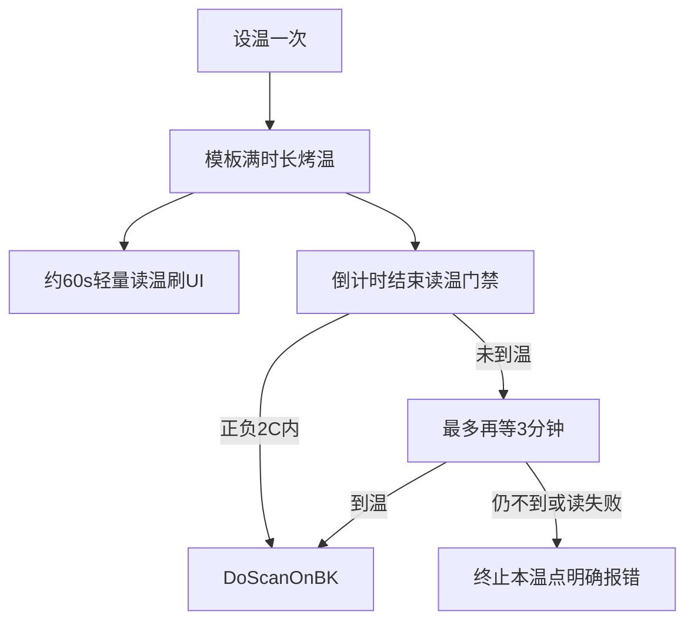

# TCC 先稳住（学习延后）

## 现场前提（已确认）

- **目标：先跑稳定**，不做升温/降温学习，不自动改烤温分钟数。
- **网口助手监测**：通讯链路整体还算稳定 → 偶发问题更宜用「开扫前确认到温」兜住，而不是在烤温里高频折腾 UDL。

## 现状摘要

| 阶段 | TCC | 问题 |
|------|-----|------|
| 进温点 | `GetCurrentTemp` / 必要时 `SetTempSetpoint` | 设备层已有锁+重试+物理结果判定 |
| 烤温 N 分钟 | **零通讯** | 纯定时；结束直接开扫 |
| 开扫前 | **无到温门禁** | 未到温也可能开扫 |

设备层 [`UDLTccCtrl`](library/DeviceControl/DeviceControl/TCC/UDLTccCtrl.cs) 保持不动。本轮只改业务烤温收尾：[`OperateInteleaverFinalTest.xaml.cs`](library/UIOperateInterleaverFinalTest/UIOperateInterleaverFinalTest/OperateInteleaverFinalTest.xaml.cs)。

## 本阶段只做（稳定）

### 1. 开扫前到温门禁（主措施）

烤温倒计时自然走完（**不做提前结束**）后：

1. `GetCurrentTemp`（完整 `UDLTccCtrl` 重试）。
2. `|实测 − 目标| ≤ 2°C` → `DoScanOnBK`。
3. 否则继续等待，最多再 **3 分钟**（期间可继续轻量读温）；到温则开扫。
4. 仍不到温或读温失败 → **明确报错并结束本温点**，禁止静默开扫。

### 2. 轻量心跳（辅措施，间隔放宽到约 60s）

链路监测已较稳，心跳目的改为：

- 给操作员看「还在升/降温」；
- 可选保活，不作为主修复手段。

约定：

- 约 **60s** 一次（比 30s 更少碰 UDL）。
- 短重试或结果回 UI，避免长时间占 UI 线程。
- 连续失败只 **RealtimeMsg / WriteLog 告警**，不杀烤温流程。
- 烤温中 **不反复 SetTempSetpoint**。

### 3. 明确不做（本阶段）

- 升温/降温学习、结构化学习日志驱动改参。
- 满 50%/90% 提前开扫。
- 自动改模板 `TmptChangeTimes`。
- FSTP+TCC 进程级大锁。

## 风险（本阶段）

| 项 | 等级 | 说明 |
|----|------|------|
| 结束后门禁 | 低～中 | 未到温会多等或失败，质量更稳、偶发产能略降 |
| 60s 心跳 | 低 | 比 30s 更轻；失败不杀流程 |
| 学习/提前结束 | — | 已砍掉 |

## 验收

- 烤温仍跑满模板时长；UI 约每分钟可见实测温度（心跳失败不中断）。
- 倒计时结束后未到 ±2°C 不会直接扫；再等最多 3 分钟仍不到则明确失败。
- 常温已在 ±5 内不烤温路径不变。
- 无学习/提前结束相关行为。
