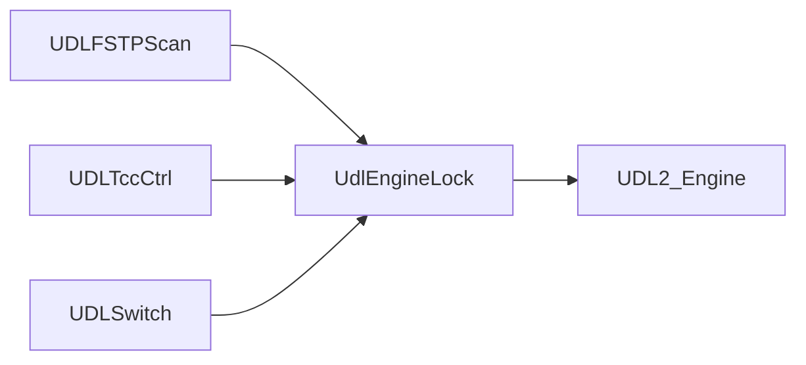

# UDL Engine 全库锁 + 应用侧重连

## 背景

主程序 TCC 偶发 `0x00120091`，关进程后 `TccTempTest`（`InitTccOnly`）正常。根因仍在 UDL，但应用可做：

1. **全库一把锁**：TCC 现有 `TccUdlLock` 罩不住 FSTP，共享 `deviceEngine` 仍会交错。
2. **失败后重连**：坏句柄上重试无意义；应用侧 Close/重建 Engine（对齐「关主程序再开小工具」）。
3. **USB 选择性挂起**：工位机系统设置，减少空闲后串口假死（与代码并行落地）。

## A. Engine 级全局锁（代码）

文件：[`DeviceHandle.cs`](library/DeviceControl/DeviceControl/DeviceHandle.cs)

- 新增 `public static readonly object UdlEngineLock = new object();`
- `GetUDLMessage` 在已持锁路径外被调用时也应安全：保持「调用方持锁」约定，并在 XML 注释写明。

[`UDLTccCtrl.cs`](library/DeviceControl/DeviceControl/TCC/UDLTccCtrl.cs)

- 删除私有 `TccUdlLock`，改为 `lock (DeviceHandle.UdlEngineLock)`（仍包在现有 `UdlUiSync.Send` 内，顺序不变：Send → lock → COM）。

[`UDLFSTPScan.cs`](library/DeviceControl/DeviceControl/FSTPScan/UDLFSTPScan.cs)

- 对所有碰 `fstpCtrl` / `GetUDLMessage` 的入口（`ScanFun`、读数、参数设置等）在 **同一把** `UdlEngineLock` 下执行。
- 扫程等待（可能数分钟）期间持锁：有意为之——烤温心跳会等扫完，避免扫中插读温污染 Engine。

[`UDLSwitch.cs`](library/DeviceControl/DeviceControl/Switch/UDLSwitch.cs)（若工位配置了 UDL 开关）

- 同样包 `UdlEngineLock`，避免第三路抢 Engine。

## B. 应用侧重连（代码）

仍在 [`DeviceHandle.cs`](library/DeviceControl/DeviceControl/DeviceHandle.cs)：

新增 `TryReopenUdlEngine(ref string errMsg)`（必须在 `UdlEngineLock` 内调用）：

1. 尝试 `CloseEngine`（若 COM 有该方法则直接调；无则 `Marshal.ReleaseComObject` 释放 `deviceEngine` / `tccCtrl` / `fstpCtrl` / `oswCtrl`）。
2. 按现有 `InitDeviceByConfig` 的 UDL 段重建：`new Engine/TCC/FSTP/OSW` → `LoadConfiguration(UDLConfig.xml)` → `OpenEngine`。
3. **不清空** 光开关等非 UDL 设备列表；仅刷新 `udlTccs` / `udlFstps`（及 UDL 开关若有）的 GUID 包装对象，与 `Deviceconfig` 中原 GUID 一致。
4. 写详细 `[UdlReopen]` 日志；成功/失败都返回。

[`UDLTccCtrl.cs`](library/DeviceControl/DeviceControl/TCC/UDLTccCtrl.cs) 触发策略：

- `GetCurrentTemp` / `SetTempSetpoint` 在 **本轮 MaxAttempts 全失败** 后：若错误像通讯硬失败（含 `0x00120091` / 读数哨兵），在锁内调用一次 `TryReopenUdlEngine`，再 **额外整轮重试一次**。
- 冷却：静态 `lastReopenTick`，例如 60s 内最多重连 1 次，避免死循环。
- 重连中不弹 UI（延续「失败不给操作员看」）；只 `WriteLog`。

不在 FSTP 扫程中途自动重连（持锁扫完后再允许 TCC 侧重连）。

## C. USB 转串口「选择性挂起」（工位机，非业务逻辑）

在 [`doc/TCC_UDL稳定性问题复盘与经验教训.md`](doc/TCC_UDL稳定性问题复盘与经验教训.md) 补一节可执行步骤（本工位机）：

1. 设备管理器 → 该 USB 串口 / USB Root Hub → 电源管理 → **取消**「允许计算机关闭此设备以节约电源」。
2. 电源选项 → 改用「高性能」或关闭 USB 选择性挂起（注册表/电源方案：`USB selective suspend` = Disabled）。
3. 烤温空闲场景复测：主程序不关进程，烤后首次读温是否仍 `0x00120091`。

可选：在 `doc/` 放一段管理员 PowerShell 示例（改当前电源方案 USB 选择性挂起），现场 IT 可跑；**不**做成程序启动时改系统电源。

## D. 验证与部署

- Debug | x86 重编 `DeviceControl` + `UIOperateInterleaverFinalTest`（及依赖）。
- 产线：`module\DeviceControl.dll` + 若 MolexUtility 有改则 `common\MolexUtility.dll`。
- 场景：主程序快扫若干轮后立刻读/设温；故意等烤温后读温；看日志是否出现 `[UdlReopen]` 且重连后恢复。
- 小工具与主程序仍勿同时开。

## 不做

- 不修改 UDL 厂商二进制。
- 不把重连做成操作员按钮（除非后续另提需求）。
- 不回退「烤后/开扫前失败不阻断快扫」的现有业务兜底。
