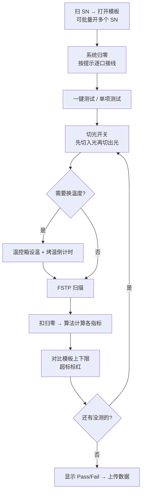

# Interleaver 光谱调节 + 终测软件 —— 5W2H 小白入门

> 适合谁读：第一次接触本项目的开发、测试、工艺、设备同事，或者"连 Interleaver 是什么都还不知道"的新人。
> 读完你应该能回答：**这个软件是干什么的、为什么要有它、谁在用、什么时候用、在哪里跑、怎么工作、规模有多大。**

---

## 0. 一句话版本

**这是一套跑在产线电脑上的 Windows 桌面软件，用同一份代码支撑 Interleaver（交织器）的两道工序：**

1. **光谱调节**（ITL_ATS）：工人一边"拧"器件，软件一边实时扫光谱、算偏差，帮他把光谱调到正确位置，再用紫外光把胶固化；
2. **终测**（ITL_FTS）：产品做好后，软件自动切光路、控温度、扫光谱、算几十个指标、判断合格与否并上传 MES。

---

## 1. 先补一点背景知识（看懂后面的前提）

### 1.1 Interleaver 是什么？

光纤里同时跑着很多不同"颜色"（频率）的光，每种颜色是一个通道，相邻通道间隔很小（例如 50 GHz）。
**Interleaver（交织器）就像一把"梳子"**：把一束密集的通道按"单数/双数"拆成两束，每束的间隔变成原来的 2 倍（例如 100 GHz）；反过来也能把两束合成一束。

```text
输入：  | | | | | | | | | |   （50GHz 间隔，所有通道挤在一起）
               ↓ Interleaver
输出1：|   |   |   |   |     （奇数通道 Odd）
输出2：  |   |   |   |   |   （偶数通道 Even）
```

所以它的**光谱是周期性的"梳状"曲线**。这条曲线长得好不好，决定了产品合不合格。

### 1.2 几个常见名词（遇到就回来查）

| 名词 | 小白解释 |
|------|----------|
| **光谱 / 扫描（Scan）** | 让光源从低频扫到高频，功率计记下每个频点的损耗，画成一条"频率-损耗"曲线 |
| **IL（插入损耗）** | 光过器件后损失了多少，越小越好（MaxIL / MinIL） |
| **ISO（隔离度）** | 不该出来的通道被压得有多低，越大越好 |
| **PDL（偏振相关损耗）** | 光的偏振方向不同时，损耗差多少，越小越好 |
| **Ripple** | 通带顶部的"起伏"，越平越好 |
| **Shift（频偏）** | 实际通道中心和标准频率（ITU 栅格）差多少，**调节工序最关心的指标** |
| **FSR（自由光谱范围）** | 梳子"齿距"，即光谱重复的周期 |
| **归零（Reference）** | 不接产品先扫一遍，记下光路本身的损耗，之后测产品时扣掉，才能得到产品真实值 |
| **模板（Template）** | 从无纸化系统/MES 下载的"测试说明书"：测哪些项、在什么温度测、上下限是多少 |
| **光开关（Optical Switch）** | 自动切换光路的设备，让一套仪器轮流测多个产品/多个端口 |
| **FSTP** | 当前产线用的扫描设备/引擎，通过 UDL 引擎调用 |
| **TCC / 循环箱** | 温控箱，用来做低温/常温/高温测试 |
| **MES / AMTS / 无纸化** | 工厂的生产管理系统，负责下发模板、接收测试数据 |
| **MIMS** | 产线软件启动平台，负责拉起本程序并传入工号、工序等信息 |

---

## 2. 5W2H 总览

| 维度 | 一句话回答 | 详见 |
|------|-----------|------|
| **What** 是什么 | 一套 WPF 插件化测试软件，同一份代码支撑"光谱调节"和"终测"两道工序 | 第 3 节 |
| **Why** 为什么 | 替代人工看仪器/算数/抄数据；保证调节准确、测试一致、数据可追溯；两道工序共享 80% 能力，合在一起维护成本最低 | 第 4 节 |
| **Who** 谁 | 产线操作员、工艺/测试工程师、设备维护、软件开发、自动化团队、MES | 第 5 节 |
| **When** 什么时候 | 器件组装后先"调节"，成品后做"终测"；每班开工先归零，归零约 6 小时失效 | 第 6 节 |
| **Where** 在哪里 | 产线工位电脑 + 光学仪器；代码在本仓库，运行目录在 `SW2219_ITL_FTS.exe` 同级 | 第 7 节 |
| **How** 怎么做 | 启动 → 读工位配置 → 加载插件 → 初始化设备 → 打开模板 → 归零 → 扫描/计算 → 判定 → 上传 | 第 8 节 |
| **How much** 多少 | 1×16 入光 + 1×32 出光开关，终测最多 16 个 SN 并行，30+ 个类库工程，归零有效期 6/6.5 小时 | 第 9 节 |

---

## 3. What —— 这个项目到底是什么？

### 3.1 它是一个"壳 + 插件"的桌面程序

可以把它想成一台**游戏主机 + 游戏卡带**：

- **主机（壳程序）**：`OCITestSystem` / 产线上叫 `SW2219_ITL_FTS.exe`。负责登录信息、读配置、加载插件、管理设备。
- **卡带（插件 DLL）**：放在 `module\` 目录下。插哪张卡，界面和业务就变成哪道工序。

| 层次 | 内容 | 举例 |
|------|------|------|
| 应用层 | 主程序窗口 | `project/OCITestSystem` |
| 插件层 | 各工序的业务界面、列表、曲线、算法 | `UIOperateInterleaver`、`UIOperateInterleaverFinalTest`、`UICurve`、`InterleaverAlgorithm` |
| 基础设施 | 公共接口、事件总线、工具类 | `MolexUtility`、`ProtocolAggregator` |
| 设备驱动 | 光开关、功率计、扫描仪、温控箱 | `DeviceControl` |

### 3.2 "两道工序一套代码"是怎么做到的？

**两道工序共享同一个壳、同一套设备驱动、同一套算法、同一套 MES 对接，只是"主业务插件"和"界面布局"不同。**

切换靠的是运行目录下的 `set\stations.xml`：

```xml
<!-- 光谱调节工位 -->
<Stationtype name="ITL_ATS" TestProcess="Adjust" MainDll="module/UIOperateInterleaver.dll"/>

<!-- 终测工位 -->
<Stationtype name="ITL_FTS" TestProcess="Test"   MainDll="module/UIOperateInterleaverFinalTest.dll"/>
```

壳程序根据工位名再去找 `module\Module_<工位名>.xml`，决定界面上摆哪些插件：

| 对比项 | 光谱调节（ITL_ATS） | 终测（ITL_FTS） |
|--------|--------------------|-----------------|
| 主业务插件 | `UIOperateInterleaver` | `UIOperateInterleaverFinalTest` |
| 布局文件 | `Module_ITL_ATS.xml` | `Module_ITL_FTS.xml` |
| 界面特点 | 5 个曲线窗（全谱 / ISO / 低频 / 中频 / 高频放大）+ **实时功率**窗 | 1 个全谱曲线窗 + 大结果表格 |
| 核心按钮 | 系统归零、**调节**、**停止**、测试、**紫外光**、上传 | 打开模板、系统归零、单项测试、**一键测试**、上传 |
| 扫描方式 | "调节"= 不带 PDL 的**连续循环扫描**；"测试"= 带 PDL 扫一次 | 带 PDL 扫描，按端口组/温度自动跑完 |
| 关心的指标 | 低/中/高频 **Shift**、FSR、MinISO、MaxIL | IL、ISO、PDL、Ripple、Shift 等模板里所有项 |
| 温度 | 常温 | 可能有低温/常温/高温，需要温控箱和烤温 |
| 并行数量 | 一个产品，Port1/2 或 Port3/4 | 最多 16 个 SN 同时测 |
| 特殊功能 | 紫外照光固化、照光前后数据保存、对接自动化运动控制 | 温控箱控温、批量开 SN、双 MPLUS 光开关路由 |

> 小知识：`UIOperateInterleaver` 内部还会看模板里有没有 `_UV` 结尾的测试对象（`IsAdjust()`）来判断是不是调节工序，是的话才显示"调节""紫外光"按钮和实时功率。

### 3.3 它**不是**什么

- 不是网页/云服务，是 **.NET Framework 4.x 的 WPF 单机 x86 程序**；
- 不是单个 exe，离开 `module\`、`set\`、`switch\` 这些目录就跑不起来；
- 不负责"拧器件"这个物理动作（调节工序里由人或自动化机械手完成），软件只负责**看**和**算**。

---

## 4. Why —— 为什么需要这个项目？

### 4.1 业务上为什么需要

| 痛点（如果没有软件） | 软件怎么解决 |
|---------------------|-------------|
| 人工手动操作光源、功率计，一个点一个点读数，慢且易错 | 一键驱动扫描仪，几秒拿到上万个点的完整光谱 |
| 调节时看不见"偏了多少"，只能凭经验拧 | 实时计算低/中/高频 Shift，曲线放大显示，边拧边看 |
| 一套仪器只能测一个口，换线靠手插拔 | 光开关自动切光路，一套仪器轮流测 16 个产品 |
| 高低温测试要人守着温控箱 | 自动设温、等温、倒计时烤温，到点自动扫 |
| 指标判定靠人对照规格书 | 从 MES 模板读上下限，超标自动标红 |
| 数据手抄、易丢、不可追溯 | 原始曲线和结果自动落盘、自动上传 MES |

### 4.2 为什么两道工序用一套代码

- **共享能力多**：模板下载、归零、扫描、光开关、算法、上传，两道工序几乎一模一样；
- **改一处，两边受益**：比如修了一个扫描或上传 bug，两个工位一起修好；
- **部署简单**：同一个发布包，改 `stations.xml` 就能变成另一个工位。

代价是：代码里两个主业务插件有不少相似逻辑，修改时要想一想"另一道工序要不要同步改"。

### 4.3 为什么现在还在继续投入（自动化）

光谱调节正在做**自动化**：由运动控制机构代替人去"拧"。软件的角色是把调节过程中的光谱数据（过程数据 + 结果数据）提供给自动化系统，形成"扫描 → 算偏差 → 机械调整 → 再扫描"的闭环。详见 [光谱调节PRD.md](光谱调节PRD.md)、[光谱调节_自动化数据接口.md](光谱调节_自动化数据接口.md)。

---

## 5. Who —— 谁和这个项目有关？

| 角色 | 他们用它做什么 | 最常接触的地方 |
|------|--------------|---------------|
| **产线操作员** | 扫 SN、点按钮、看 Pass/Fail、上传 | 主界面按钮、结果表格、红字 |
| **工艺 / 测试工程师** | 定义模板和规格、分析失败、调整测试流程 | MES 模板、`rawdata\` 曲线、日志 |
| **设备维护工程师** | 接线、配串口、维护光开关指令表 | `set\Deviceconfig.xml`、`switch\` 目录、"设置 → 设备配置" |
| **软件开发** | 改业务逻辑、加设备、修 bug | `library\` 源码、`doc\` 文档 |
| **自动化团队** | 通过 TCP/共享目录/网关驱动调节流程、读光谱数据 | `光谱调节_自动化数据接口.md`、`project/ITL.AutomationGateway.Api` |
| **MES / 无纸化系统** | 下发模板、接收测试结果 | `FusionControl`（软件内的对接模块） |
| **MIMS 平台** | 启动程序、传入工号/工序/模式 | 启动参数 AppInfo |

---

## 6. When —— 什么时候用？

### 6.1 在生产流程中的位置


- **光谱调节**：器件内部光学元件还没固定时用。调到 Shift 合格 → 照紫外光把胶固化 → 再测一次确认 → 上传。
- **终测**：产品基本完成后用，做出货前的"期末考试"。

### 6.2 一个班次里的时间点

| 时机 | 要做什么 |
|------|---------|
| 开机 / 开班 | 启动软件，看状态栏是否"设备正常初始化" |
| 每次开始测试前 | **系统归零**（若归零已过期） |
| 归零约 6 小时后 | 自动失效，必须重新归零（未开模板 6 小时、已开模板 6.5 小时；界面会计时并标红提醒） |
| 每个产品 | 扫 SN → 打开模板 → 测试 → 上传 |
| 换批次 / 换光路 | 建议重新归零 |

---

## 7. Where —— 在哪里？

### 7.1 物理上

- **产线工位电脑**（Windows），通过串口 / 网口连着：
  - 扫描设备（FSTP，经 UDL 引擎）
  - 功率计
  - 光开关（终测：入光 1×16 + 出光 1×32 两台 MPLUS）
  - 温控箱 TCC（终测高低温时）
  - 紫外照光设备（调节工序）
- 光路示意图见 [物理拓扑图.png](物理拓扑图.png)、[工位接线图.png](工位接线图.png)、[1X16.png](1X16.png)、[1X8.jpg](1X8.jpg)。

### 7.2 代码在仓库里的位置

```text
SW2219_ITL_FTS/
├── project/OCITestSystem/                 ← 壳程序（主窗口）
├── project/ITL.AutomationGateway.Api/     ← 给自动化/第三方用的 .NET 8 网关
├── library/
│   ├── UIOperateInterleaver/              ← ★ 光谱调节 主业务
│   ├── UIOperateInterleaverFinalTest/     ← ★ 终测 主业务
│   ├── UIListInterleaver/、UIListCommon/  ← 结果表格
│   ├── UICurve/                           ← 曲线
│   ├── RealtimePower/                     ← 实时功率（调节用）
│   ├── UIRealTimeStatus/                  ← 右侧日志
│   ├── InterleaverAlgorithm/              ← 指标计算算法
│   ├── DeviceControl/                     ← 所有设备驱动
│   ├── ConfigModel/                       ← "设备配置"界面
│   ├── MolexUtility/                      ← 公共接口、MES 对接、工具
│   └── ProtocolAggregator/                ← 模块间事件总线
├── doc/                                   ← 文档（你现在在这里）
└── bin/                                   ← 编译输出 / 运行目录样例
```

> 名字里带 `-old`、`- tool`、`-bk` 的目录是历史副本，**一般不要改**。

### 7.3 运行时的目录（exe 同级）

| 目录 | 放什么 |
|------|-------|
| `module\` | 所有插件 DLL + `Module_<工位>.xml` 布局 |
| `set\` | `stations.xml`（选工位）、`Deviceconfig.xml`（设备）、`UDLConfig.xml` 等，**GB2312 编码** |
| `switch\` | 光开关路由指令表（每台开关一个文件） |
| `reference\` | 归零数据 |
| `rawdata\` | 扫描原始曲线 CSV |
| `temple\` | 模板缓存 |
| `lightdata\` | 照光前后数据（调节工序） |
| 共享目录（如 `D:\ITL_SpectrumShare`） | 给自动化读的光谱数据（调节工序） |

---

## 8. How —— 它是怎么工作的？

### 8.1 启动过程（两道工序相同）

```mermaid
flowchart TD
    A[MIMS 启动 exe<br/>传入工号/工序/模式] --> B[读 set\stations.xml<br/>确定是 ITL_ATS 还是 ITL_FTS]
    B --> C[读 module\Module_工位.xml<br/>决定界面摆哪些插件]
    C --> D[MEF 自动加载 module\ 下的 DLL]
    D --> E[读 set\Deviceconfig.xml<br/>初始化光开关/功率计/扫描仪/温控箱]
    E --> F[广播"初始化完成"<br/>各插件开始工作]
```

> **MEF** 是 .NET 自带的插件机制：插件 DLL 上贴个"我叫 XXX"的标签，壳程序扫描目录就能自动找到并装上，不需要互相引用。
> 插件之间通过**事件总线**（`ProtocolAggregator`）发消息，比如"模板更新了""这一行数据算好了""画这条曲线"。

### 8.2 光谱调节（ITL_ATS）怎么用

```mermaid
flowchart TD
    A[扫 SN → 打开模板] --> B[系统归零]
    B --> C[选 Port1/2 或 Port3/4]
    C --> D[点"调节"<br/>无 PDL 连续扫描]
    D --> E{看 Shift / ISO<br/>是否合格?}
    E -- 不合格 --> F[人工 / 机械手<br/>调整器件]
    F --> D
    E -- 合格 --> G[点"停止"]
    G --> H[点"紫外光"<br/>照光固化]
    H --> I[点"测试"<br/>带 PDL 扫一次确认]
    I --> J[上传数据]
```

关键点：

- **"调节"按钮会一直循环扫**，直到点"停止"，方便边拧边看；
- 界面上同时显示**全谱 + 低/中/高三个频点的放大曲线**，以及每个频点的 Shift 数值；
- 右上角**实时功率**窗口给出功率计读数；
- 照光前后的数据会分别保存，便于对比"固化后有没有跑偏"；
- **自动化模式**下（`AutomationType == 1`），由自动化系统发 TCP 命令触发：

  | 自动化发 | 软件做 |
  |---------|-------|
  | `SNNO;{SN}` | 打开模板 |
  | `TEST;NOPDL` | 调节扫描一次，写共享目录，回 `DATA;READY` + `TEST;PASS;...` |
  | `TEST;PDL` | 测试扫描，回结果 |
  | `TEST;UV;...` | 照光分支 |

### 8.3 终测（ITL_FTS）怎么用



一次扫描内部的数据流（开发要看的）：

```text
SetSwitch 切光开关
  → DoScan（IUDLFSTP.Scan，写 CSV）
  → InterleaverScanResult 读 CSV、扣归零
  → ParamCal + InterleaverAlgorithm 算 IL/ISO/PDL/Ripple/Shift...
  → FusionControl.UpdateTestData 对比上下限
  → EventListItemUpdate 事件 → 表格刷新（不合格红字带 *）
  → EventCurveUpdate → 曲线刷新
```

### 8.4 光开关是怎么切的（终测）

- 两台 MPLUS 光开关：**入光 1×16**（选哪个产品）、**出光 1×32**（选哪个输出口给哪个功率计）；
- 软件只生成一个"标志"，比如入光 `3::3:16`（第 3 个产品，入通道 3），出光 `1::5:32`；
- 标志对应的真实串口命令写在 `switch\interleaverSwitch-MPLUS-IN` / `-OUT` 文件里，**改线时改文件，不改代码**。

### 8.5 想切换工位怎么办？

1. 把对应 `stations.xml`（例如 `stations_ITL_FTS.xml` 或 `stations-interleaverATS.xml` 的内容）放到 `set\stations.xml`；
2. 确认 `module\Module_<工位名>.xml` 存在；
3. 确认 `set\Deviceconfig.xml` 中设备与该工位接线一致；
4. 重启软件。

---

## 9. How much —— 规模有多大？

| 项 | 数值 | 来源 |
|----|------|------|
| 支撑工序 | 2 道（光谱调节 ITL_ATS + 终测 ITL_FTS） | `stations*.xml` |
| 同框架下的其它产品线插件 | Demux、CIR、1×8 PD、LLCC、ITLCD、物料测试等 | `library/UIOperate*` |
| `library\` 下的工程目录 | 30+ 个（含历史副本） | 仓库目录 |
| 终测光开关规模 | 入光 1×16 + 出光 1×32 | `OpticalSwitchConfigNames` |
| 终测最多并行 SN | 16 个（7 端口及以上产品按 16 ÷ 端口数计算） | `GetMaxProductsForPortCount` |
| 批量打开 SN | 一次最多 16 个 | 终测"批量打开 SN" |
| 归零有效期 | 未开模板 6 小时 / 已开模板 6.5 小时 | 终测超期判断逻辑 |
| 调节关注频点 | 低 / 中 / 高三个频点（如 191300 / 193600 / 196000 GHz） | 调节界面 |
| 单次扫描点数 | 上万点量级（接口示例为 10001 点） | 自动化数据接口 |
| 运行平台 | Windows，.NET Framework 4.6.1~4.8，x86 | 工程配置 |

> 测试节拍（每件多少秒）取决于模板项目数、温度点数和烤温时间，代码里没有固定值，请以产线实测为准。

---

## 10. 小白上手路线（建议顺序）

1. **先看图**：[主界面截图.png](主界面截图.png)、[物理拓扑图.png](物理拓扑图.png)，知道软件长什么样、光怎么走；
2. **再看操作**：[usermanual.md](usermanual.md)（终测用户手册），照着走一遍流程；
3. **理解架构**：[SW2219_ITL_FTS_设计文档.md](SW2219_ITL_FTS_设计文档.md)、[project_relationships.md](project_relationships.md)；
4. **读终测主流程**：[主流程概括.md](主流程概括.md) → [UIOperateInterleaverFinalTest_代码说明.md](UIOperateInterleaverFinalTest_代码说明.md) → [ITL_FTS_终测核心数据流.md](ITL_FTS_终测核心数据流.md)；
5. **读调节与自动化**：[光谱调节PRD.md](光谱调节PRD.md) → [光谱调节_自动化数据接口.md](光谱调节_自动化数据接口.md) → [interleaver_spectrum_adjustment_automation_summary.md](interleaver_spectrum_adjustment_automation_summary.md)；
6. **动手**：用 VS 打开 `library/OCI Library.sln` 编译，用 `project/OCITestSystem.sln` 调试主程序。

---

## 11. 新人常踩的坑

| 坑 | 说明 |
|----|------|
| 改了代码但界面没变 | 编译输出的 DLL 没拷到运行目录的 `module\` |
| 界面空白 / 找不到插件 | `Module_*.xml` 里的 `Module="..."` 名字和插件的 `ExportMetadata("name", ...)` 不一致 |
| 配置文件中文乱码 | `set\` 下的 XML 必须用 **GB2312** 保存 |
| 光开关切换失败 | 检查 `switch\` 指令文件名是否等于设备 ShowName、COM 口和波特率是否正确 |
| 一直提示"未归零" | 归零数据缺失或已过 6 小时，重新归零 |
| 只改了终测，调节没改 | 两道工序是两个主业务插件，共性逻辑要考虑同步 |
| 误改了 `-old` 目录 | 那是历史副本，实际生效的是不带后缀的工程 |
| 没硬件怎么调试 | 只能验证界面和配置加载；可用 `set\DisableUDLEngine.txt` 跳过 UDL |
